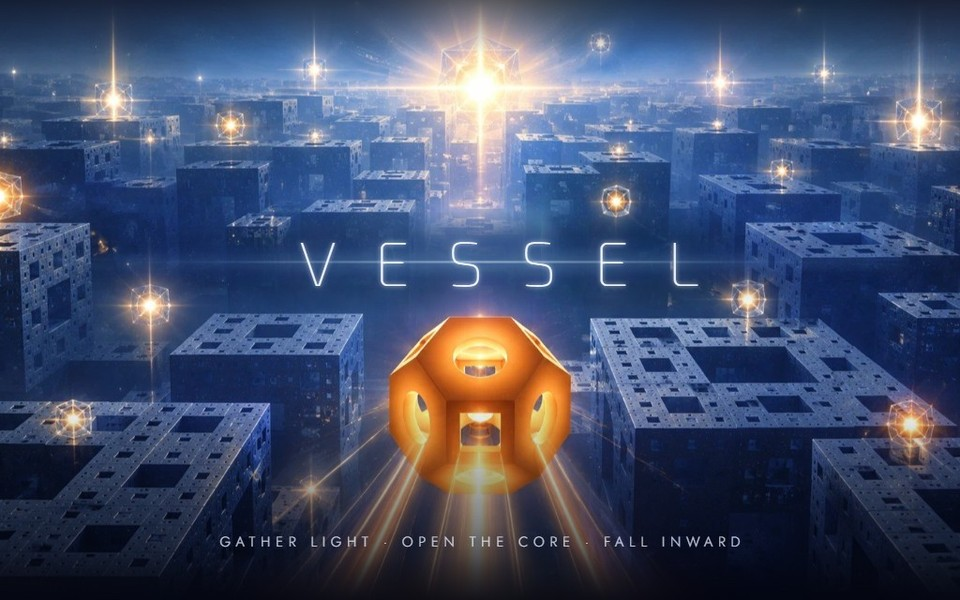

# Gal Barkan

3D artist, musician, and creator of games and apps. I turn my own 3D artwork and music into
browser games and interactive tools, built with Three.js.

## Games

<table>
<tr>
<td width="50%" valign="top">

<h3>Digiplanes</h3>
Roll a wireframe cage across fifteen themed planes drawn like a technical drawing, each with its own palette and soundtrack.
  
<b><a href="https://gb1577.github.io/digiplanes/">▶ Play</a></b>
</td>
<td width="50%" valign="top">

<h3>Hyperloops</h3>
Fly a shard of light through low-poly worlds at 160 BPM.
  
<b><a href="https://gb1577.github.io/hyperloops/">▶ Play</a></b>
</td>
</tr>
<tr>
<td width="50%" valign="top">

<h3>LightRide</h3>
Ride the beat through eight digital realms, from Halo City to the mirror plains of Digi-Planes.
  
<b><a href="https://gb1577.github.io/lightride/">▶ Play</a></b>
</td>
<td width="50%" valign="top">

<h3>Vessel</h3>
Explore the endless expanses of fractal space: thirty raymarched layers, from Menger cities to a Mandelbrot sea.
  
<b><a href="https://gb1577.github.io/vessel/">▶ Play</a></b>
</td>
</tr>
</table>

All four play in the browser on desktop and mobile. The art and music are my own.

## Elsewhere

[Website](https://www.galbarkan.com/) ·
[ArtStation](https://www.artstation.com/galbarkan) ·
[YouTube](https://www.youtube.com/@gal-barkan) ·
[Instagram](https://www.instagram.com/gal.barkan/) ·
[Bandcamp](https://galbarkan.bandcamp.com/) ·
[X](https://www.twitter.com/gal_barkan)

For licensing or collaboration, get in touch through [galbarkan.com/contact](https://www.galbarkan.com/contact).
