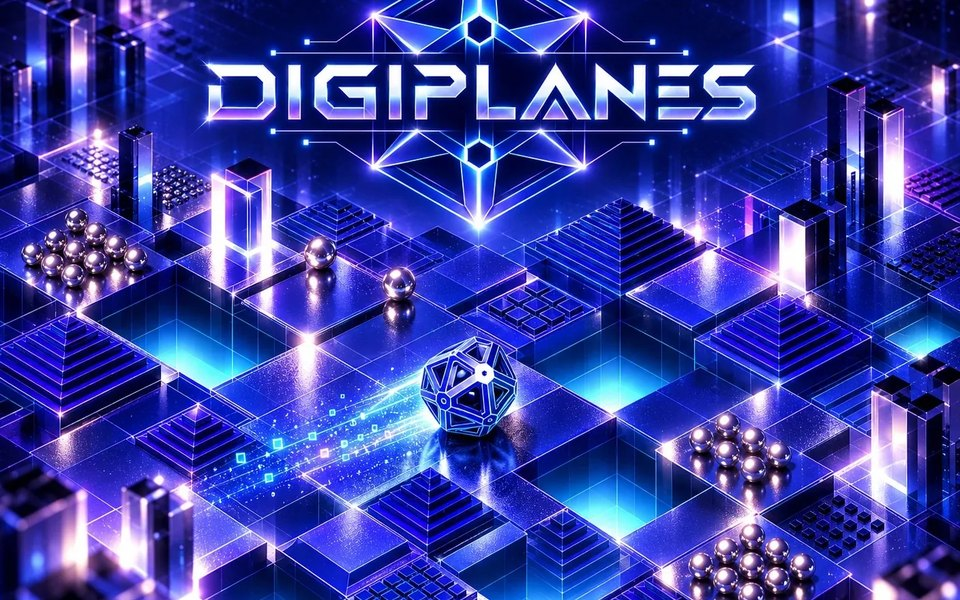
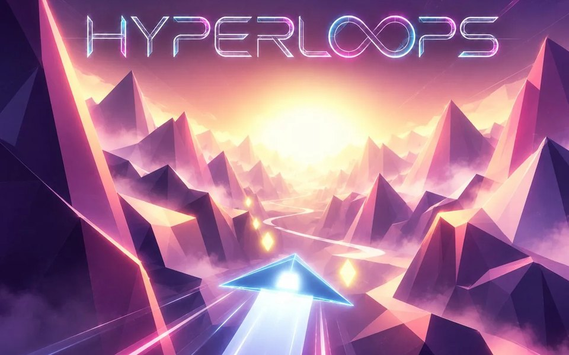
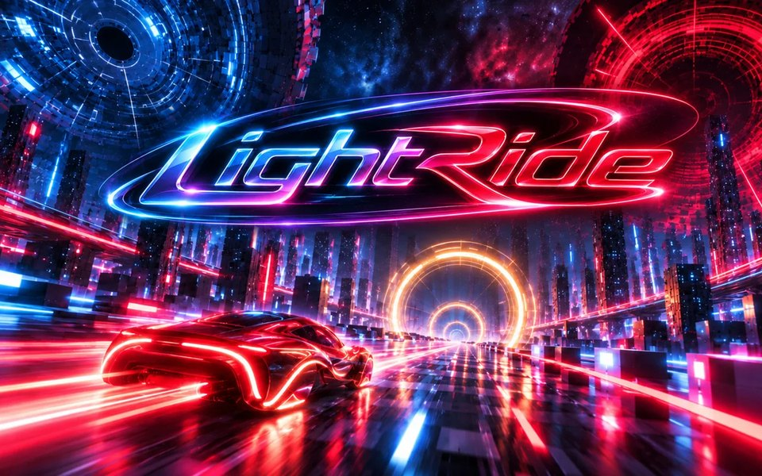

# Gal Barkan

3D artist, musician and game maker. I build small browser games from my own 3D artwork and music,
using Three.js.

## Games

<table>
<tr>
<td width="33%" valign="top">

<h3>Digiplanes</h3>
Roll a wireframe cage across fifteen themed planes drawn like a technical drawing, each with its own palette and soundtrack.
  
<b><a href="https://www.galbarkan.com/games/digiplanes">▶ Play</a></b>
</td>
<td width="33%" valign="top">

<h3>Hyperloops</h3>
Fly a shard of light through low-poly worlds at 160 BPM.
  
<b><a href="https://www.galbarkan.com/games/hyperloops">▶ Play</a></b>
</td>
<td width="33%" valign="top">

<h3>LightRide</h3>
Ride the beat through eight digital realms, from Halo City to the mirror plains of Digi-Planes.
  
<b><a href="https://www.galbarkan.com/games/lightride">▶ Play</a></b>
</td>
</tr>
</table>

All three play in the browser on desktop and mobile. The art and music are my own.

## Elsewhere

[Website](https://www.galbarkan.com/) ·
[ArtStation](https://www.artstation.com/galbarkan) ·
[YouTube](https://www.youtube.com/@gal-barkan) ·
[Instagram](https://www.instagram.com/gal.barkan/) ·
[Bandcamp](https://galbarkan.bandcamp.com/) ·
[X](https://www.twitter.com/gal_barkan)

For licensing or collaboration, get in touch through [galbarkan.com/contact](https://www.galbarkan.com/contact).
