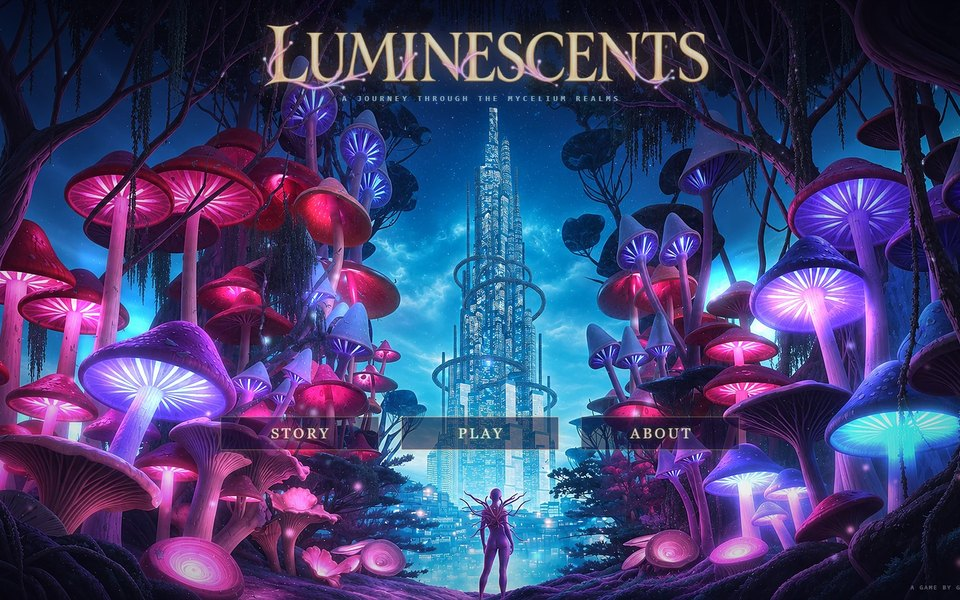
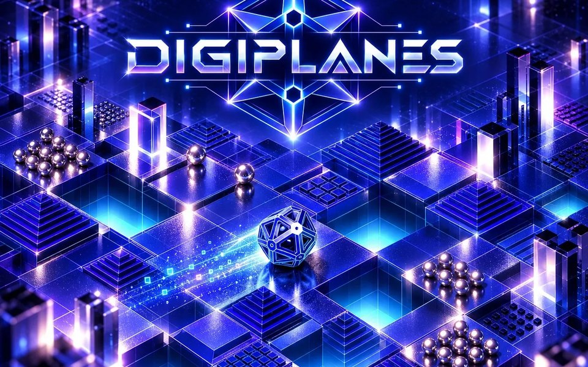
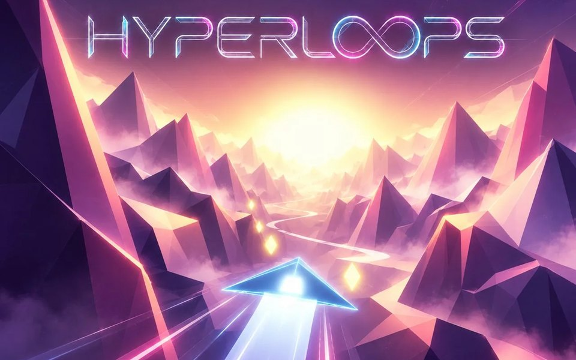
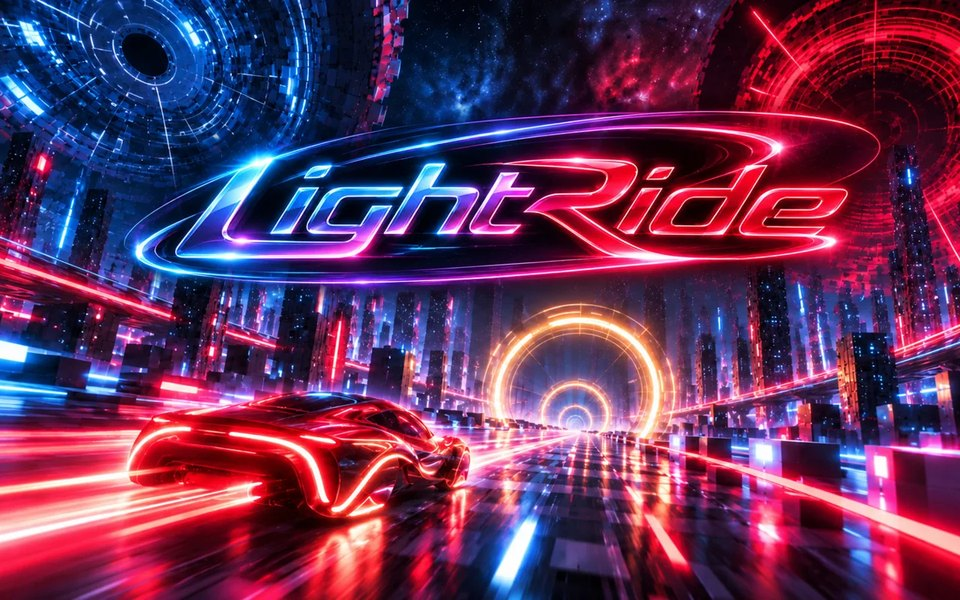
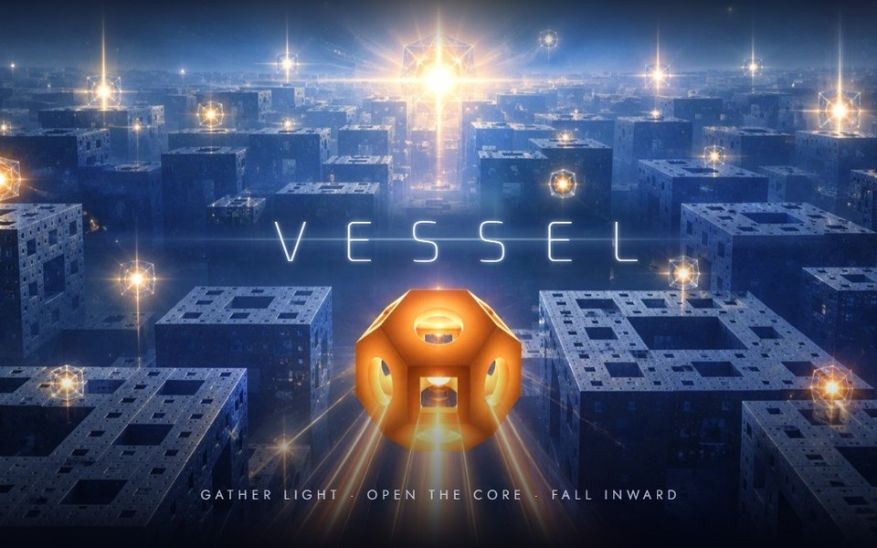

# Gal Barkan

3D artist, musician, and creator of games and apps. I turn my own 3D artwork and music into
browser games and interactive tools, built with Three.js and WebGL.

## Games

<table>
<tr>
<td width="50%" valign="top">

<h3><a href="https://github.com/gb1577/gb1577/tree/main/games/luminescents">Luminescents</a></h3>
A 2D platformer through eight painted worlds of giant glowing mushrooms, tree cities and towers of light.
  
<b><a href="https://gb1577.github.io/Luminescents/">▶ Play</a></b> &nbsp;·&nbsp; <a href="https://youtu.be/1UrddGb26_U">Trailer</a> &nbsp;·&nbsp; <a href="https://github.com/gb1577/gb1577/tree/main/games/luminescents">Screenshots &amp; info</a>
</td>
<td width="50%" valign="top">

<h3><a href="https://github.com/gb1577/gb1577/tree/main/games/digiplanes">Digiplanes</a></h3>
Roll a wireframe cage across fifteen themed planes drawn like a technical drawing, each with its own palette and soundtrack.
  
<b><a href="https://gb1577.github.io/digiplanes/">▶ Play</a></b> &nbsp;·&nbsp; <a href="https://github.com/gb1577/gb1577/tree/main/games/digiplanes">Screenshots &amp; info</a>
</td>
</tr>
<tr>
<td width="50%" valign="top">

<h3><a href="https://github.com/gb1577/gb1577/tree/main/games/hyperloops">Hyperloops</a></h3>
Fly a shard of light through low-poly worlds at 160 BPM.
  
<b><a href="https://gb1577.github.io/hyperloops/">▶ Play</a></b> &nbsp;·&nbsp; <a href="https://github.com/gb1577/gb1577/tree/main/games/hyperloops">Screenshots &amp; info</a>
</td>
<td width="50%" valign="top">

<h3><a href="https://github.com/gb1577/gb1577/tree/main/games/lightride">LightRide</a></h3>
Ride the beat through eight digital realms, from Halo City to the mirror plains of Digi-Planes.
  
<b><a href="https://gb1577.github.io/lightride/">▶ Play</a></b> &nbsp;·&nbsp; <a href="https://github.com/gb1577/gb1577/tree/main/games/lightride">Screenshots &amp; info</a>
</td>
</tr>
<tr>
<td width="50%" valign="top">

<h3><a href="https://github.com/gb1577/gb1577/tree/main/games/vessel">Vessel</a></h3>
Explore the endless expanses of fractal space: thirty raymarched layers, from Menger cities to a Mandelbrot sea.
  
<b><a href="https://gb1577.github.io/vessel/">▶ Play</a></b> &nbsp;·&nbsp; <a href="https://github.com/gb1577/gb1577/tree/main/games/vessel">Screenshots &amp; info</a>
</td>
<td width="50%" valign="top"></td>
</tr>
</table>

All five play in the browser on desktop and mobile. The art and music are my own.

## Elsewhere

[Website](https://www.galbarkan.com/) ·
[ArtStation](https://www.artstation.com/galbarkan) ·
[YouTube](https://www.youtube.com/@gal-barkan) ·
[Instagram](https://www.instagram.com/gal.barkan/) ·
[Bandcamp](https://galbarkan.bandcamp.com/) ·
[X](https://www.twitter.com/gal_barkan)

For licensing or collaboration, get in touch through [galbarkan.com/contact](https://www.galbarkan.com/contact).
