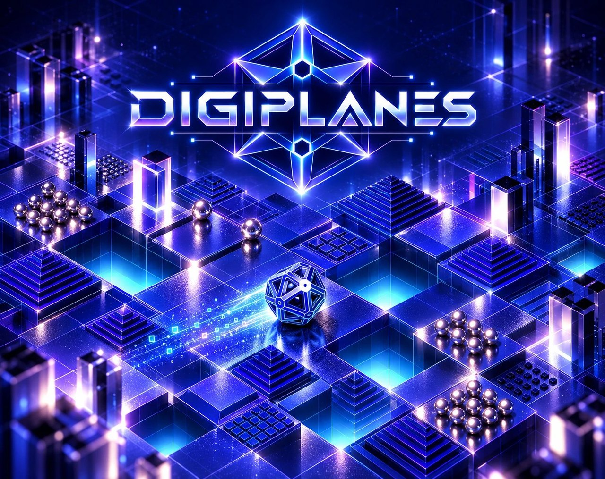
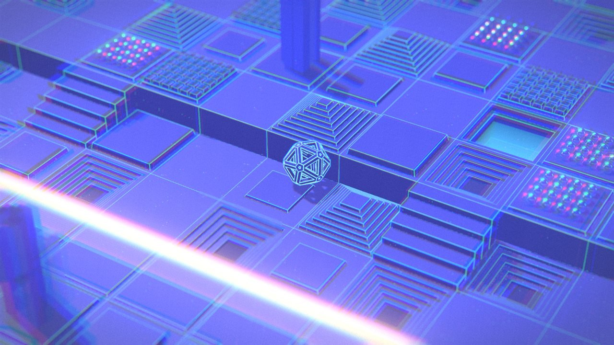
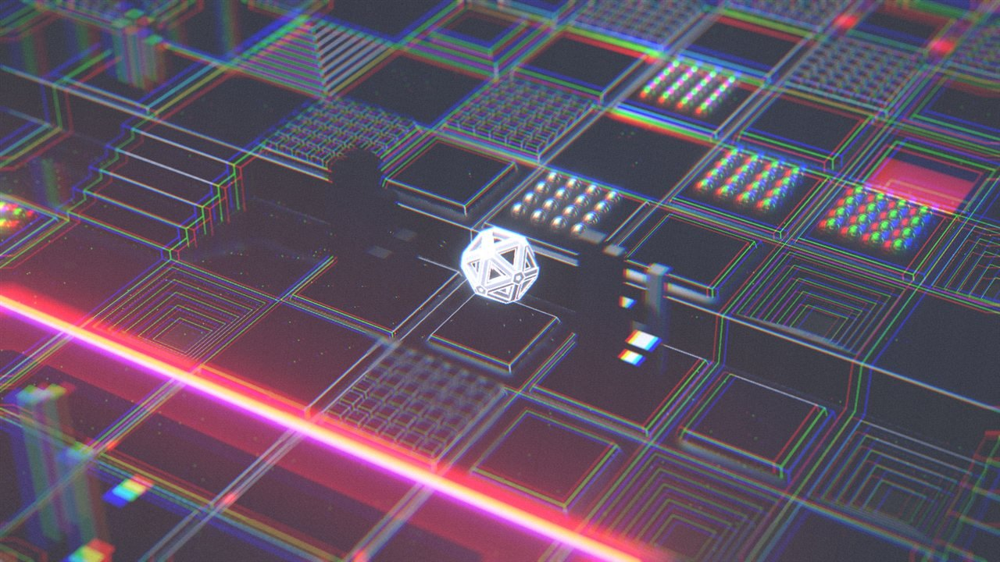
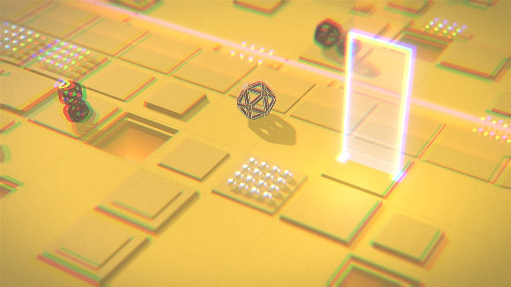
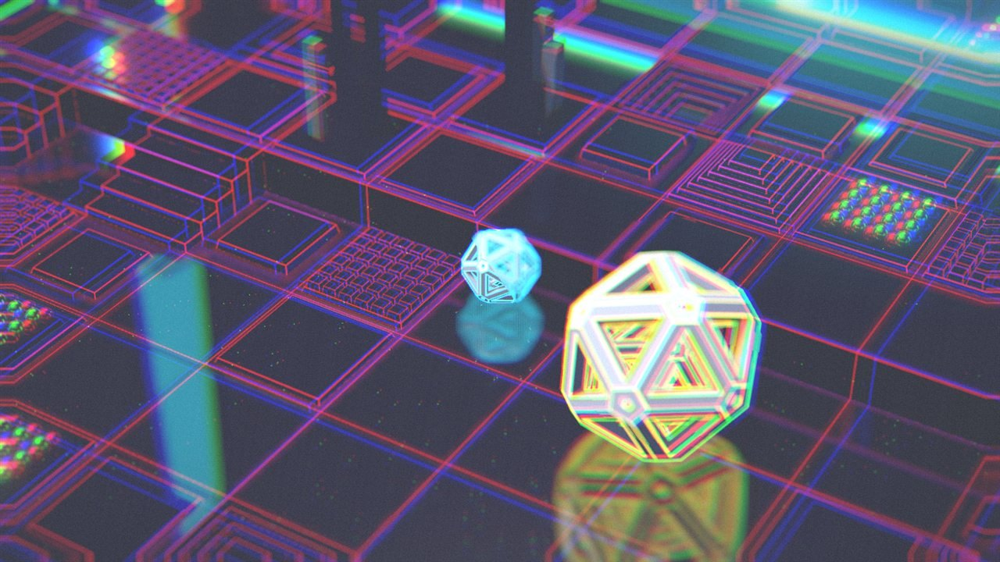
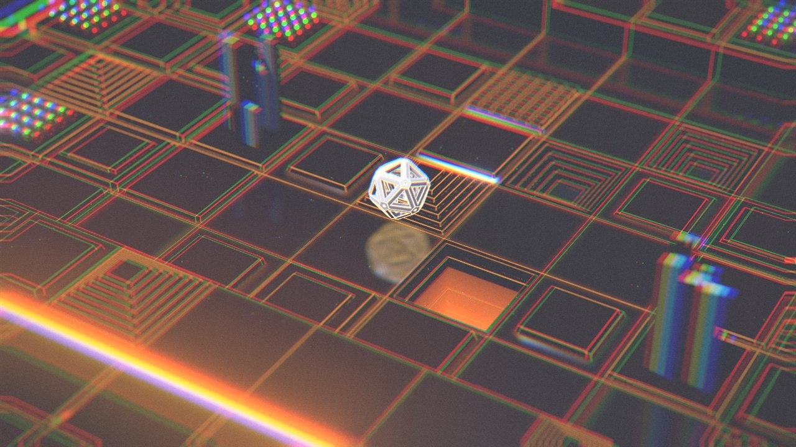
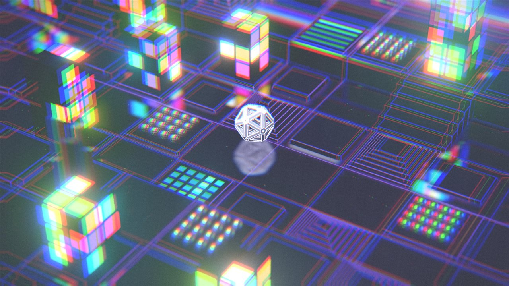
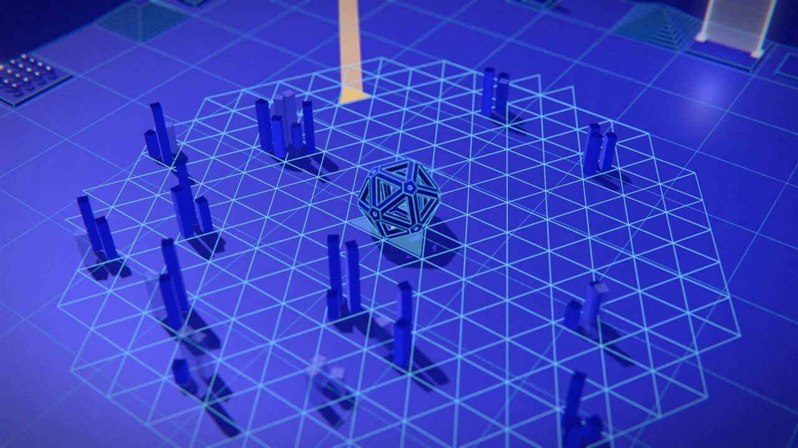

# Digiplanes

### ▶ [Play in your browser](https://gb1577.github.io/digiplanes/)

A small Three.js browser game drawn like a technical drawing. You roll a wireframe cage across
15 themed planes, each with its own palette and its own soundtrack.

| | |
|---|---|
|  |  |
|  |  |
|  |  |
|  | |

- **Cage** mode: scoop up marbles (12 at most) and roll them into the lit portal to bank them.
  Banking refuels the clock, and a full load scores ×2. The hunter cage gets faster after every
  bank, so ram the chrome balls into it to stun it.
- **Puzzle** mode: the cage tips face by face over a triangle grid. Land the glowing face on the
  glowing target.

## Controls

| | Cage | Puzzle |
|---|---|---|
| Move | WASD, or hold left-click and drag | WASD or click to tip |
| Action | Space or right-click to hop | Z undo · N skip |
| Retry | R | R |

`1` / `2` switch modes, `[` / `]` change plane, and `M` mutes (remembered between visits).

## Music and the Glass FM synth

Each plane plays its own song, live on a small Web Audio FM synth. **Glass FM** (the ♪ SYNTH tab in the game) is the
synth on its own page. Its playlist holds all 15 plane songs, so you can audition them, play the synth from the
keyboard and tweak patches.

[← All games](../../README.md)
