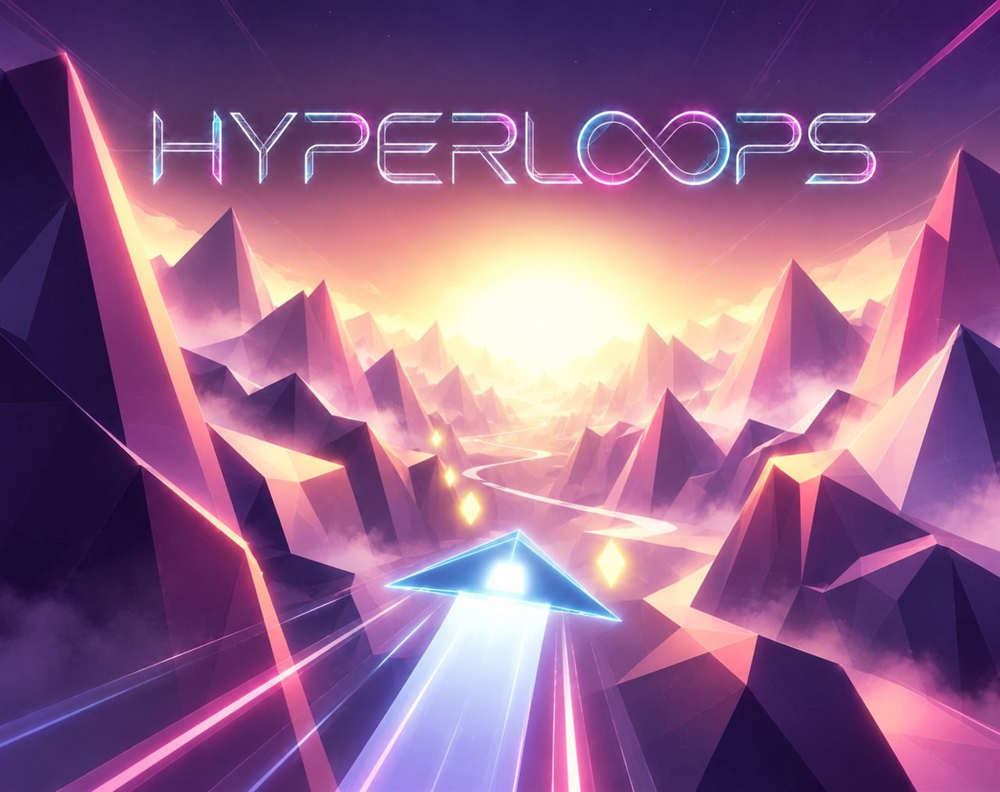
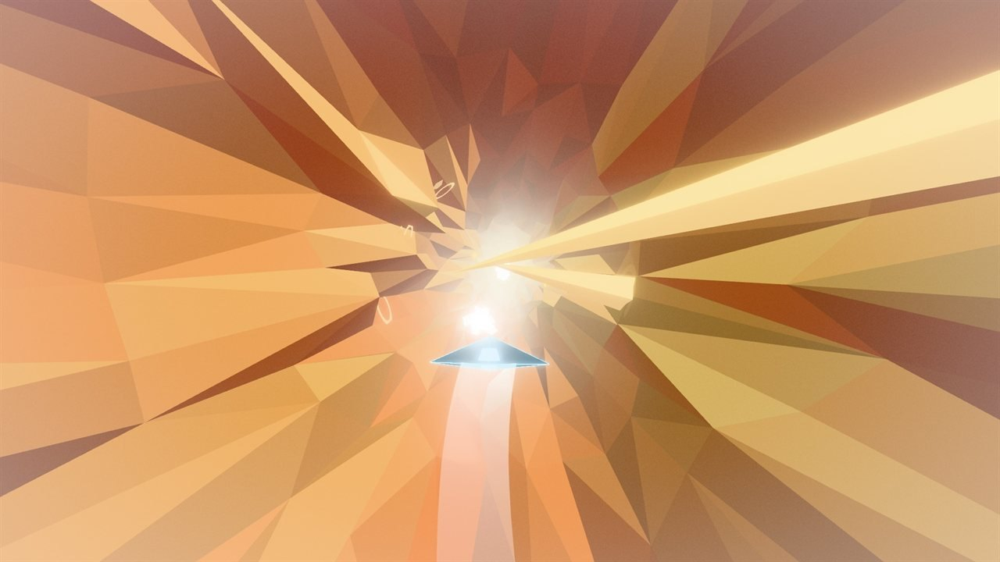
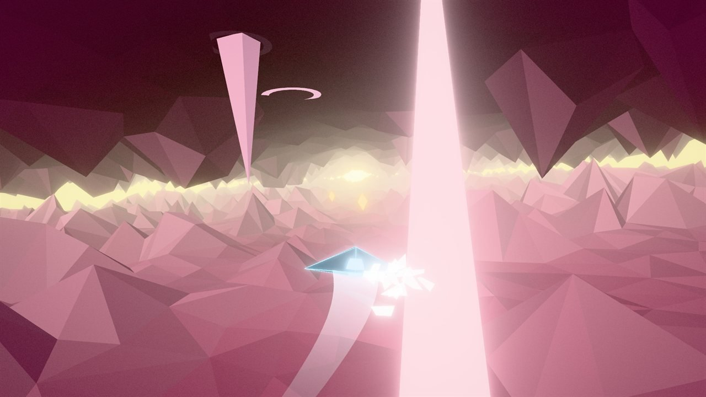
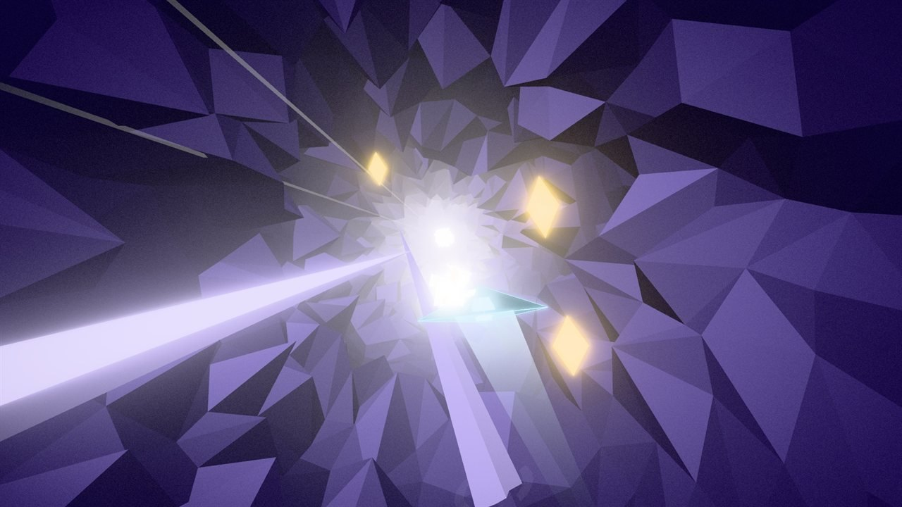
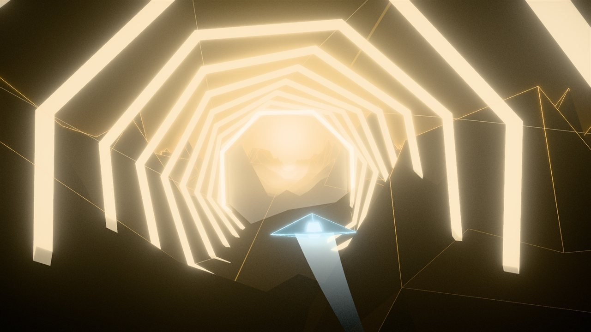
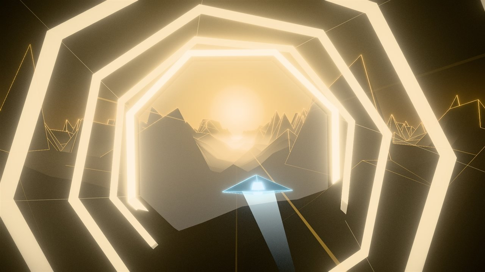
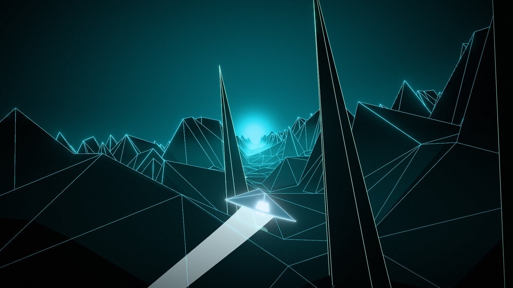

# HYPERLOOPS

**Fly a shard of light through low-poly worlds, on the beat.**

### ▶ [Play in your browser](https://gb1577.github.io/hyperloops/)

A rhythm graze-runner for the browser: crystal spikes erupt on the beat of a 160 BPM soundtrack, and you thread
through them as close as you dare, grab gold shards and dive through a hyperloop into the next of 15 worlds.
Built from my 2016 After Effects music video (the first ten levels recreate its scenes).

## Screenshots

| | |
|---|---|
|  |  |
|  |  |
|  |  |

## How to play

Fly a light-shard through 15 levels, on the beat (160 BPM).

- **Steer** with the mouse, WASD / arrow keys, a gamepad, or touch-drag.
- **Crystal spikes** erupt on the beat. A glowing ring on the ground warns one beat ahead.
  Patterns change every bar: walls with one gap, slaloms, spikes aimed at you, scatter.
- **Graze** (fly close past a spike without touching it) for +100 × multiplier.
- **Gold shards** sit in risky spots (in the gaps, next to spikes). Collect them for points, with a rising chime.
- **Skim** low over the ground for a score and Flux trickle.
- **3 shields.** A hit cracks one, muffles the music and drains the colour. Losing all three
  restarts the current level instantly.

Pick **EASY** (5 shields, fewer spikes, wider gaps, no aimed spikes) or **HARD** on the start screen.

| Key | Action |
|---|---|
| Esc | pause / resume |
| M | mute / unmute |

[← All games](../../README.md)
