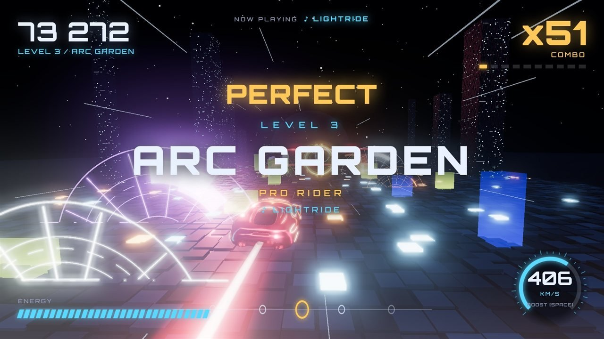
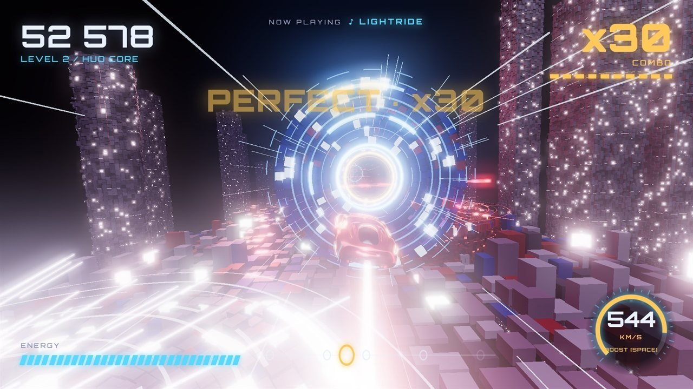
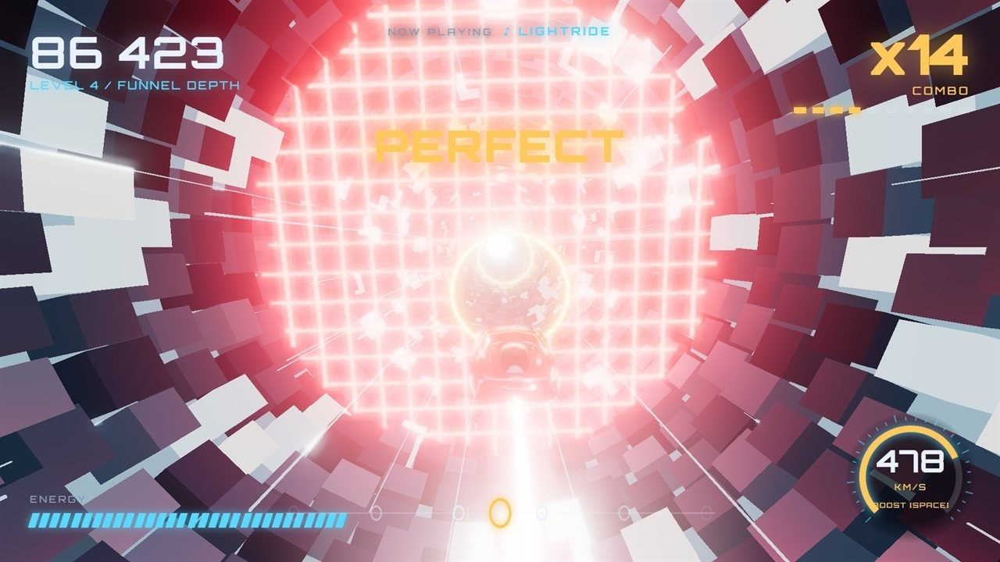
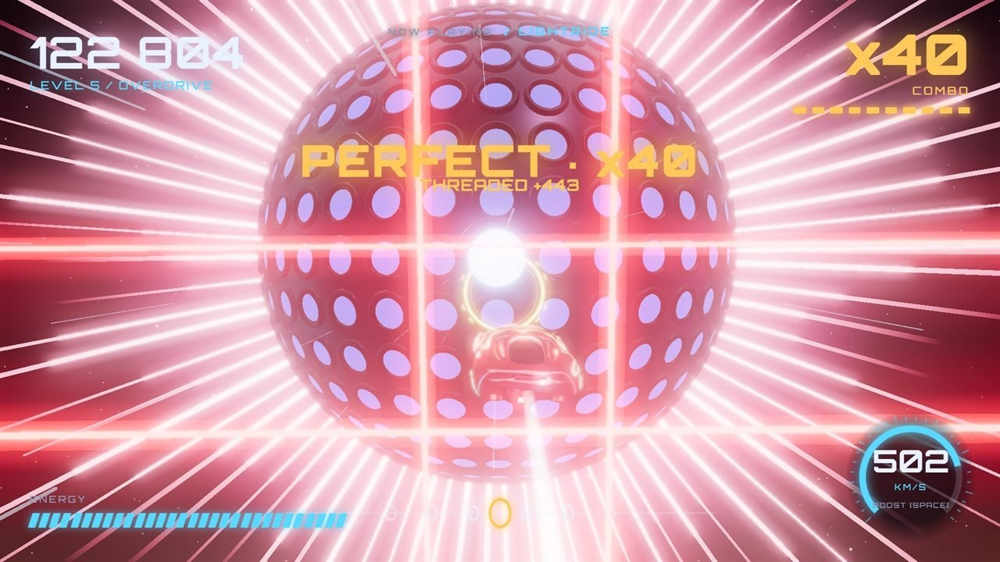
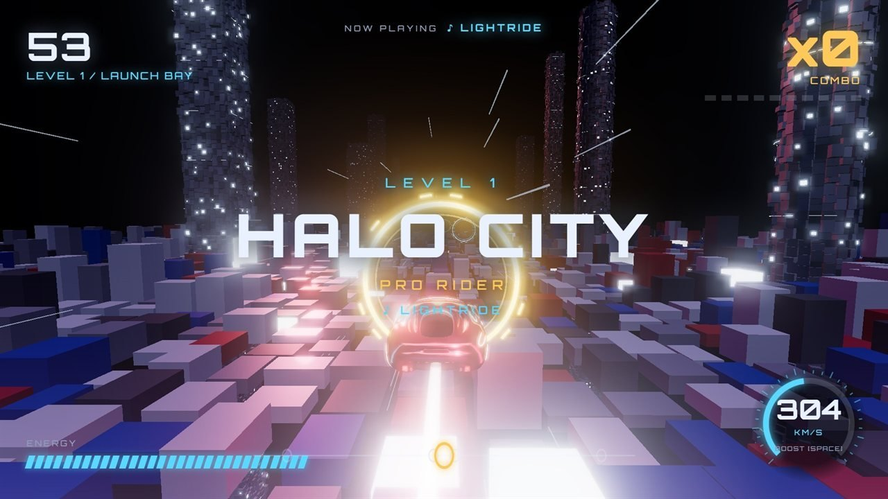
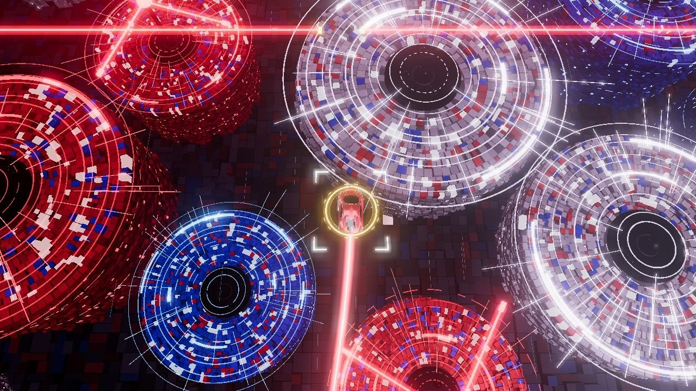
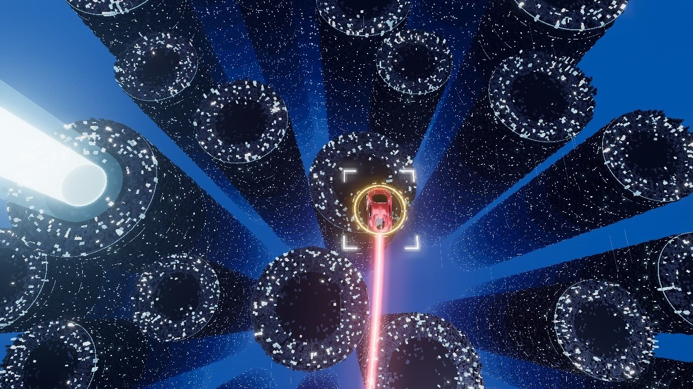
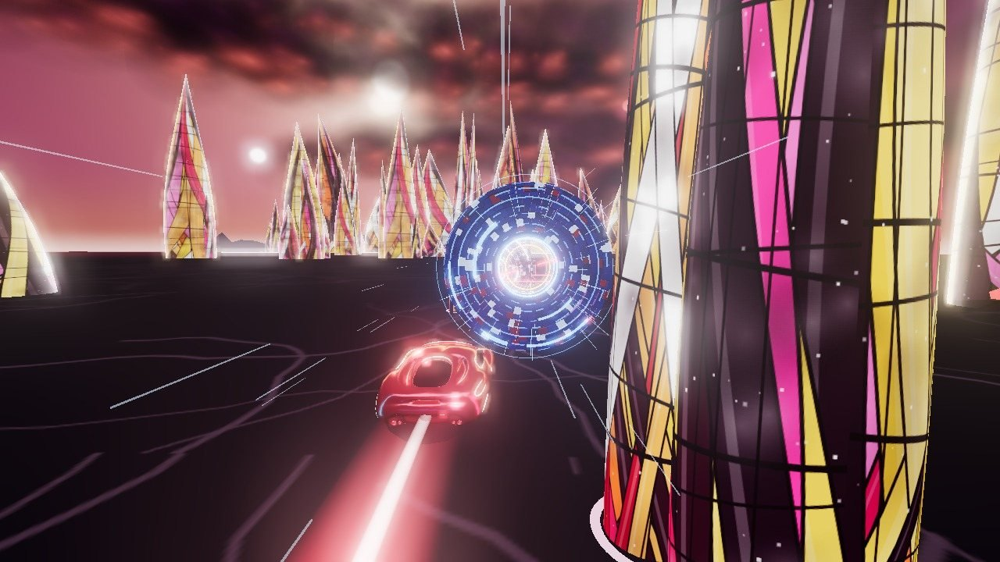

# LightRide

**Rhythm flying game in your browser: ride the beat through 8 digital realms.**

### ▶ [Play in your browser](https://gb1577.github.io/lightride/)

Pilot your light-rider through 8 digital realms, from Halo City to the top-down Disc Array and Core Stacks to the
mirror plains of Digi-Planes, where every ring lands on the beat of the soundtrack. Thread the rings, chain combos
and hit dead centre for PERFECT.

## Screenshots

| | |
|---|---|
|  |  |
|  |  |
|  |  |
|  |  |

## Controls

| Key | Action |
|---|---|
| Mouse / WASD | Steer (touch: drag anywhere) |
| Space (hold) | Overdrive: double points, burns energy |
| C | Switch camera |
| P / M | Pause / mute |

Also on itch.io: https://gb1577.itch.io/lightride

Made with Blender 3D & Claude Opus 5.5

[← All games](../../README.md)
