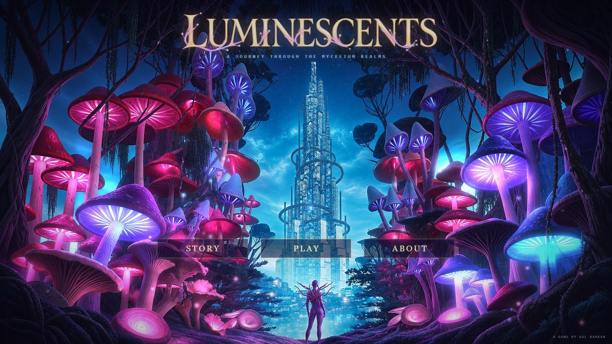
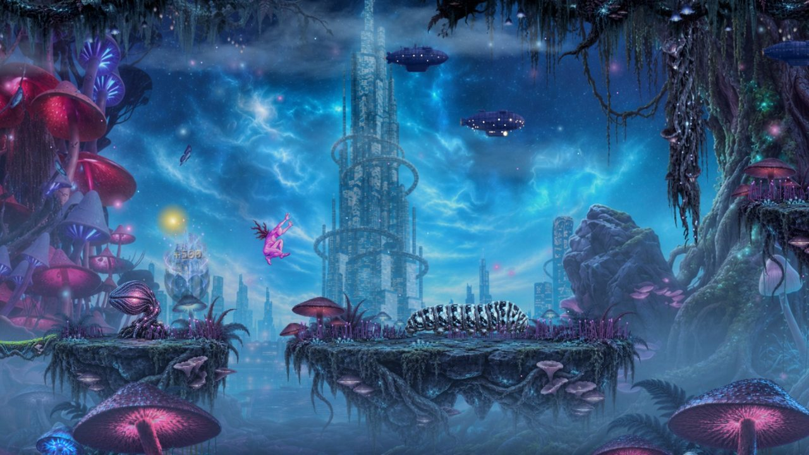
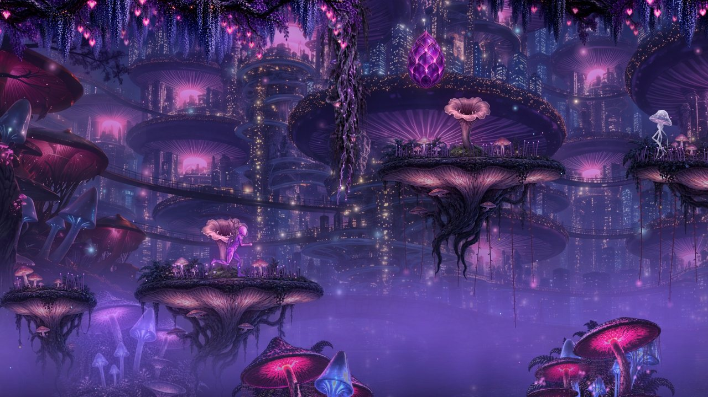
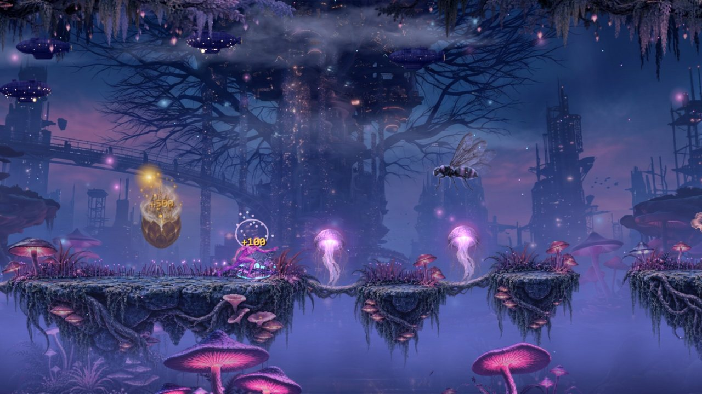
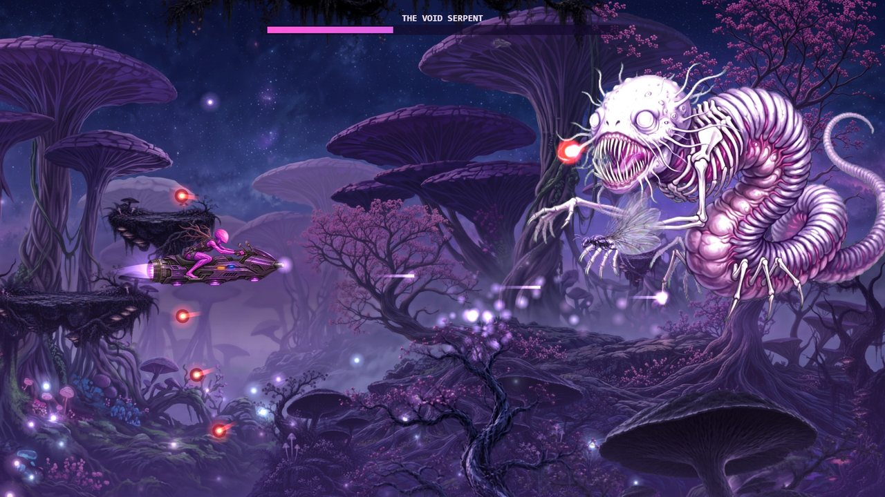
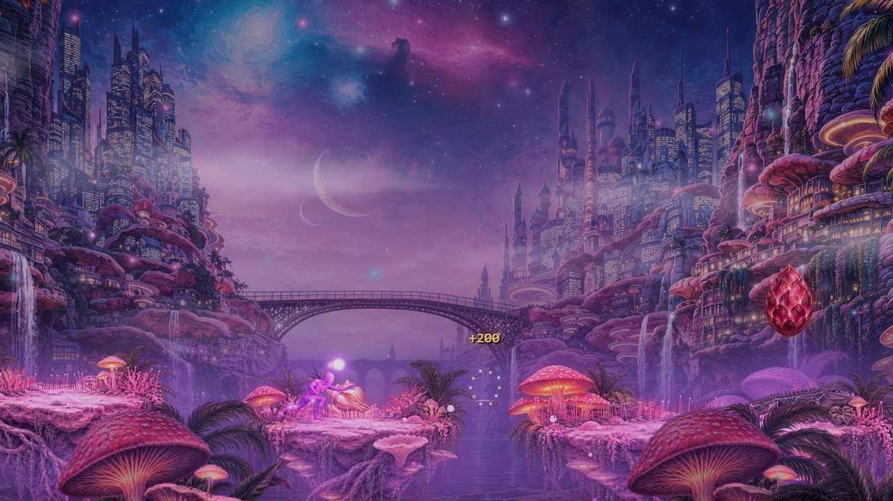
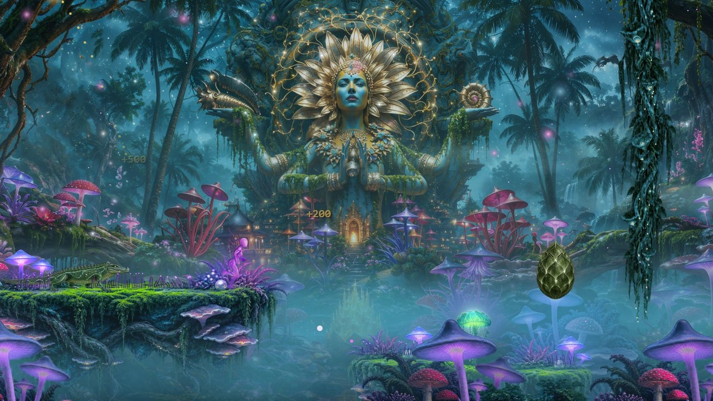
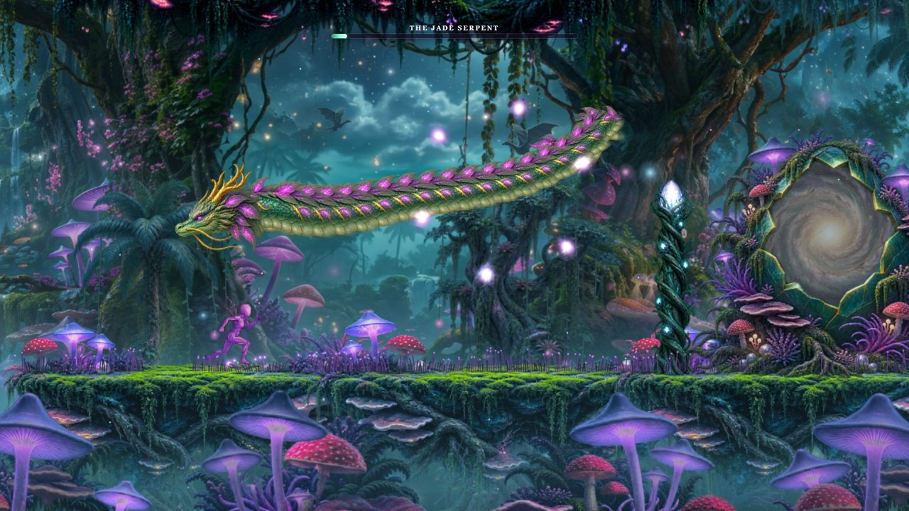
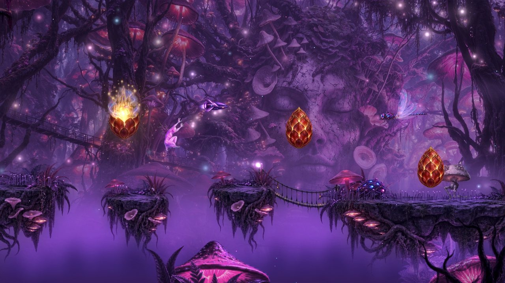

# Luminescents

### ▶ [Play in your browser](https://gb1577.github.io/Luminescents/) · 🎬 [Watch the trailer](https://youtu.be/1UrddGb26_U)

A 2D platformer through eight painted worlds of giant glowing mushrooms, tree cities and towers of light.
Every world began as one of my 3D artworks.

You are a Luminescent, a spirit woken from the Mycelium root. Run, jump, climb swaying vines and dash
through the worlds. Gather the scattered light, face each world's guardian, and step through the
galaxy eggs, the doors between the worlds, to bring the light home.

| | |
|---|---|
|  |  |
|  |  |
|  |  |
|  |  |

- Eight worlds: Mycelium World, Bioluminocities, Luminescent Forest, Treeverse, Night Cities, Fantasy Beach,
  Psychedelica Forest and Oracular Grove
- A boss battle for each world's guardian, and a shoot-'em-up flight on a hover-bike through the night skies
- A told story at the start and the end
- Each world has its own chiptune / synthwave song, played live on a Web Audio synth

## Controls

| | Keyboard | Touch |
|---|---|---|
| Move | ← → or A D | stick, bottom left |
| Jump (hold for higher) | Space, W or ↑ | JUMP |
| Throw light | X or J | LIGHT |
| Dash | Shift, S or K | DASH |
| Climb a vine | ↑ ↓ or W / X | stick |
| Pause / menu | Esc | ❚❚ top right |

Flight: arrow keys / WASD to steer, hold Space or the mouse button to fire.

[← All games](../../README.md)
