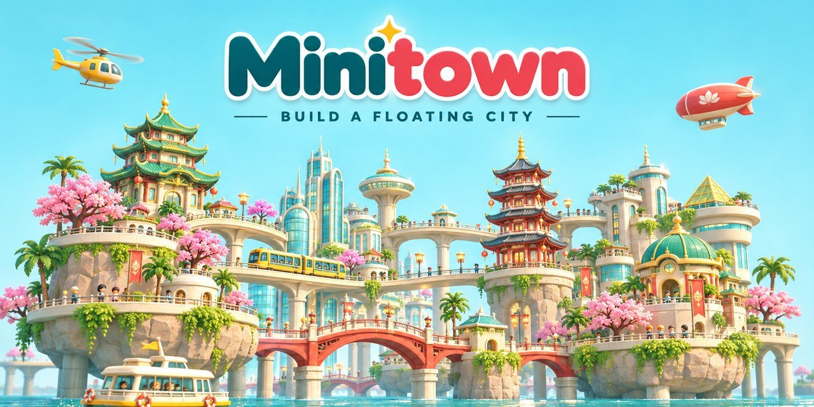
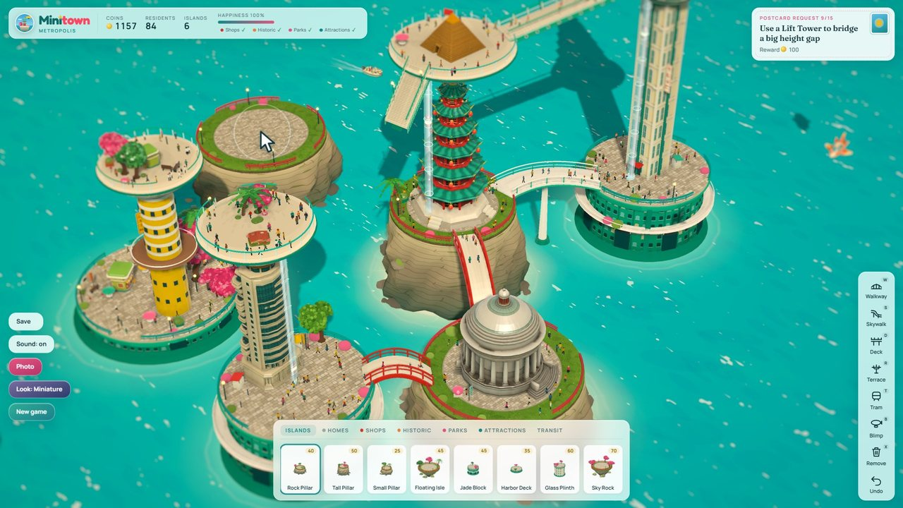
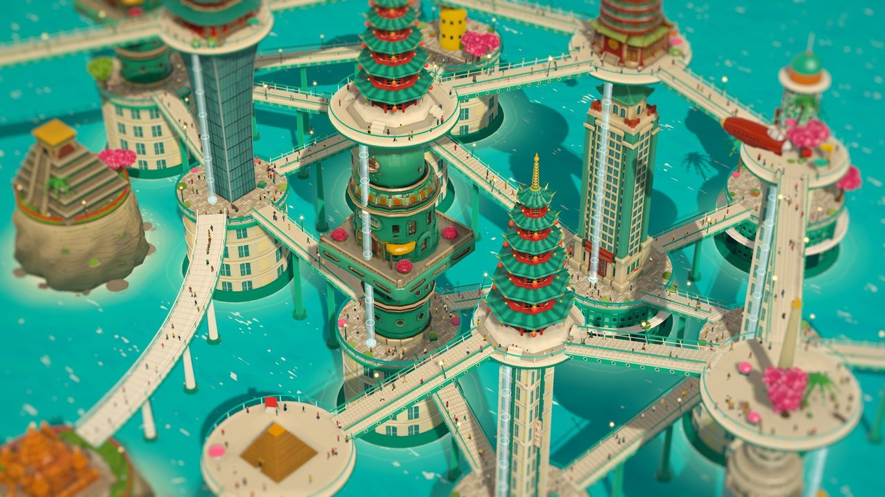
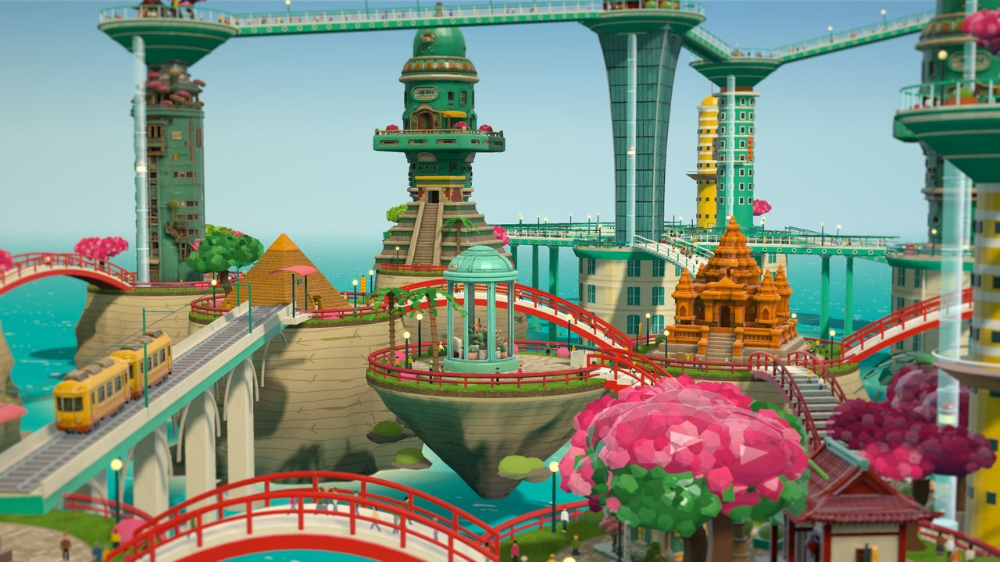
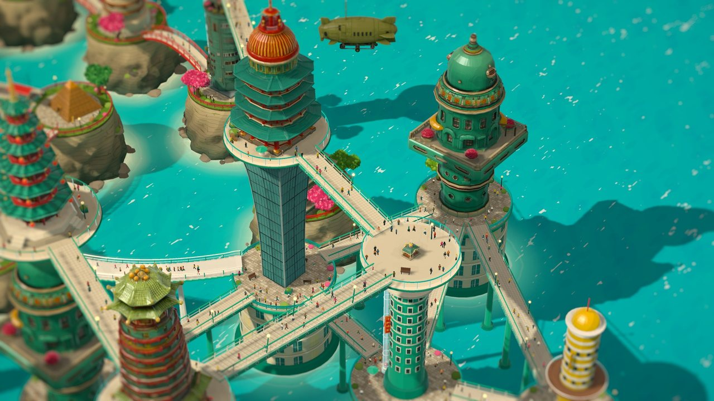
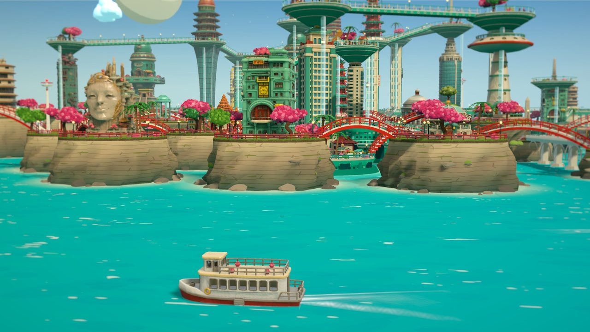
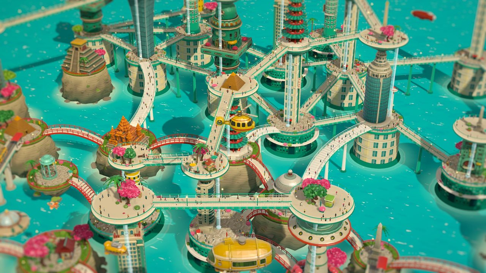
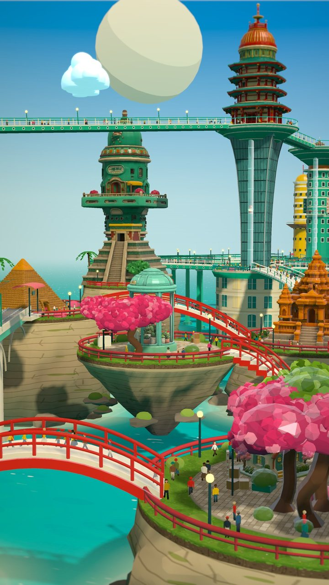
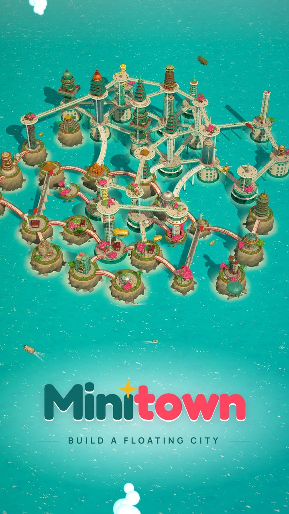

# MINITOWN

**Build a floating city.**

### ▶ [Play in your browser](https://gb1577.github.io/minitown/)

A city builder set in a tilt-shift diorama. Raise islands from a turquoise sea and crown them with pagodas, temples,
saucer towers and glass skyscrapers. Then stitch them together with red arched bridges, sky decks, trams and blimp
routes. Residents only move into a town they can get around, so every bridge you draw fills with tiny commuters.
Ferries cross the lagoon, airships drift overhead, and the hamlet grows into a busy miniature metropolis.

## Screenshots

| | |
|---|---|
|  |  |
|  |  |
|  |  |

  
  

## How to play

Place islands, build homes, shops, culture and attractions on them, and link everything with walkways, skywalks,
decks, terraces, trams and blimp routes. Residents arrive as homes connect to places to visit. Grow from Hamlet to
Village, Town, City and Metropolis to unlock more buildings and transport. Postcard requests give you goals. There
is no fail state, and the town saves in the browser.

## Controls

| Desktop | | Touch | |
|---|---|---|---|
| Left-drag | orbit | One finger | move the map |
| Right-drag | pan | Pinch | zoom |
| Wheel | zoom | Twist | turn |
| W S D R T B | link tools | Tap | pick and place |
| X · Ctrl Z | remove · undo | | |
| H · O | hide UI · change look | | |

Plays on desktop, iPhone and iPad. Several looks: Miniature, Toon, Painted and Pixel art.

[← All games](../../README.md)
