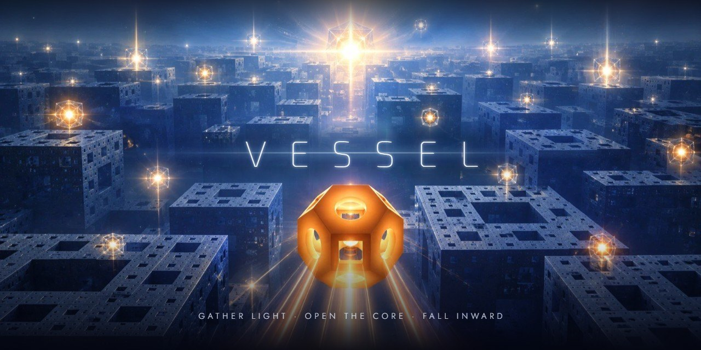
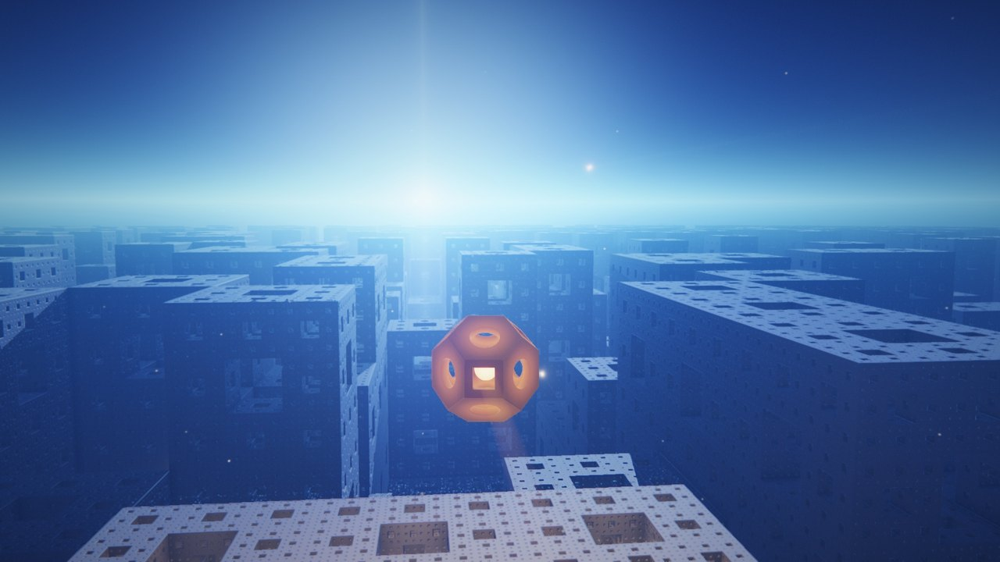
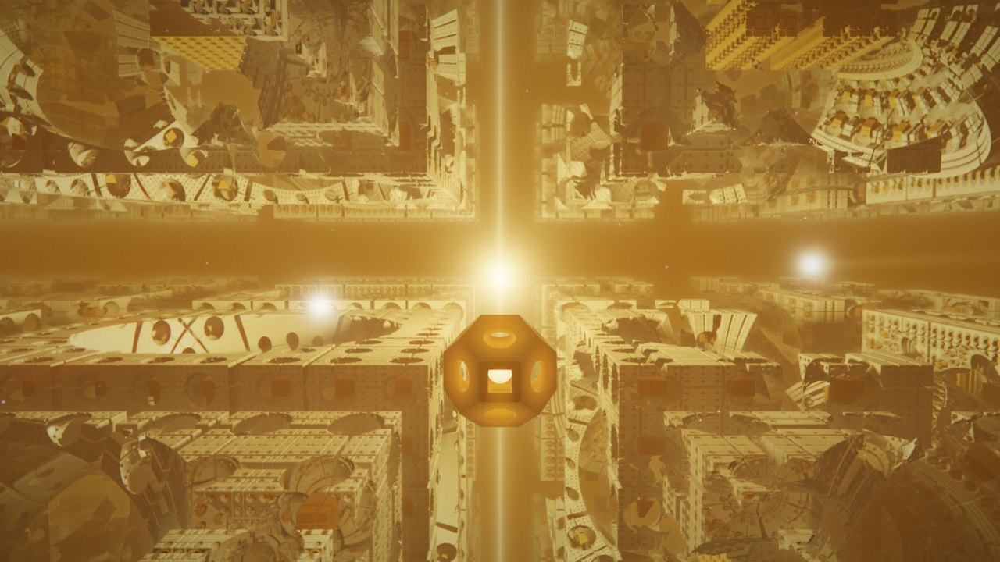
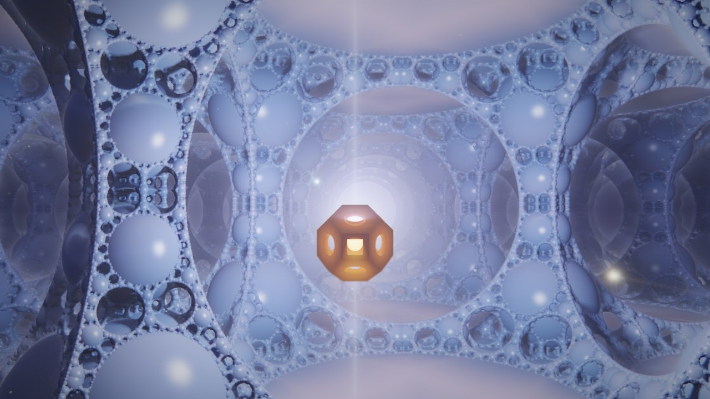
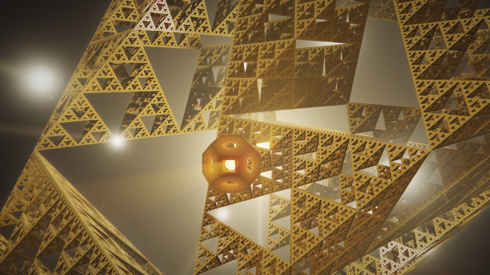
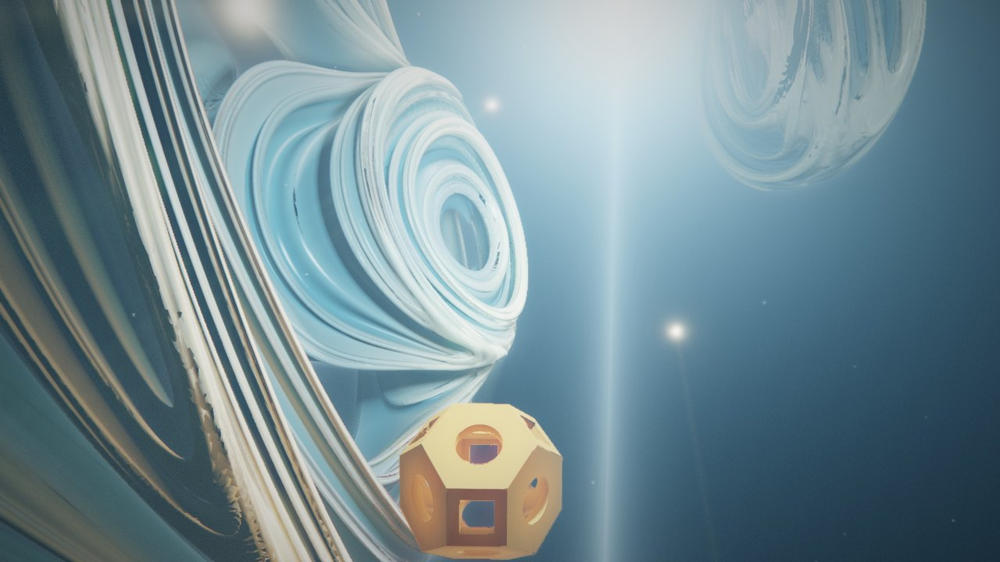
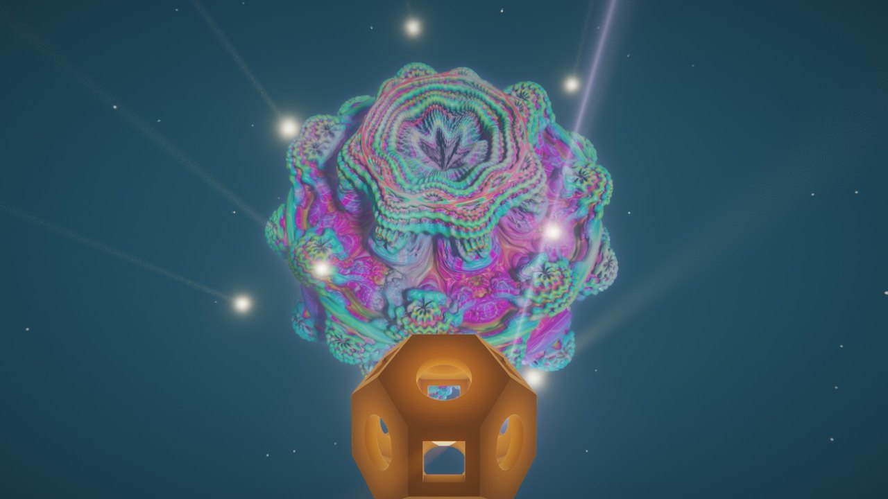
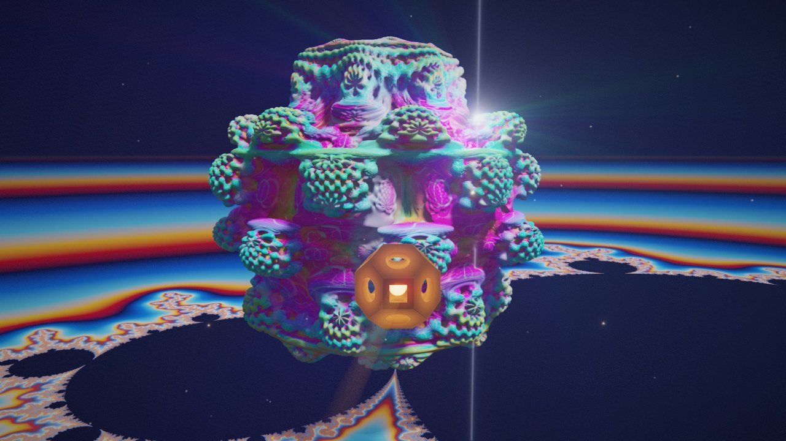
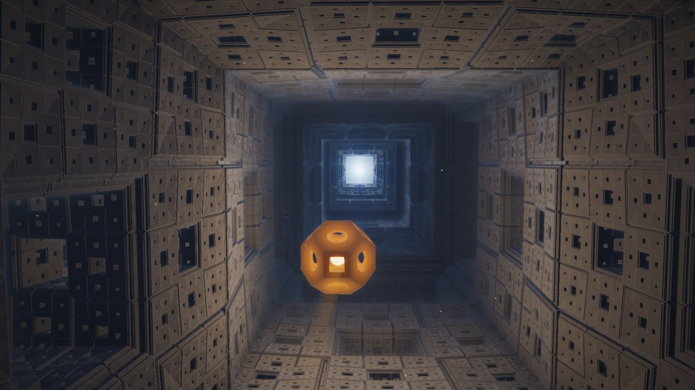
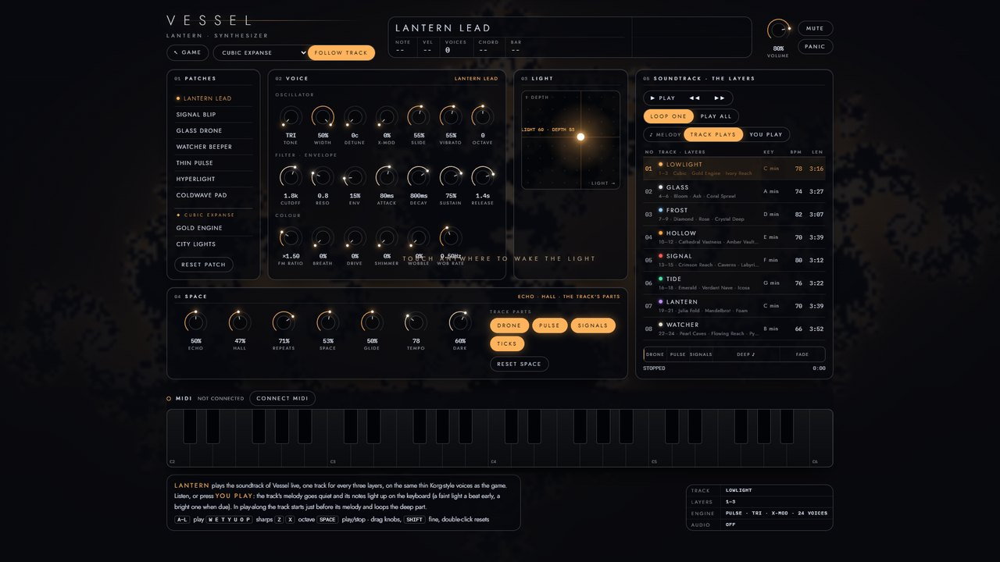

# VESSEL

**Explore the endless expanses of fractal space.**

### ▶ [Play in your browser](https://gb1577.github.io/vessel/)

A slow flight game for the browser. You steer a small vessel carrying a lantern through thirty layers of fractal
space: Menger cities, gold engines, bubble foam, Sierpinski pyramids, Julia folds, Mandelbulb blooms and a
Mandelbrot sea. Gather the light hidden in each layer's caverns, open its core and fall inward to the next.
Shrink to slip through any opening, or grow to take in the whole of it. Everything is raymarched live on the GPU,
and the soundtrack is generated as you play.

## Screenshots

| | |
|---|---|
|  |  |
|  |  |
|  |  |
|  |  |

## Sound

An original subtractive synth soundtrack: thin Korg-style voices, a different track every three layers, and an
arrangement that follows the game (a drone at first, then pulse and signals, a melody once the core opens).
**Lantern** (♪ on the title screen) is a playable synthesizer with MIDI: listen to every track, or let the melody
go quiet and play it yourself.

## Controls

| Desktop | | Touch | |
|---|---|---|---|
| Mouse | steer, in any direction | Drag anywhere | steer |
| Click · W / S | fly / back | Hold FLY | fly |
| Scroll · Q E | shrink · grow | Pinch | shrink · grow |
| Space · C | rise · sink | ▲ ▼ | rise · sink |
| A · D | strafe | ◎ | face the light |
| Shift | boost | ⌂ | return to the source |
| R | face the light | ❚❚ | pause |
| H | return to the source | | |
| G · M | quality · music | | |
| 1–9 · [ ] | choose a layer | | |
| Esc | pause | | |

Any layer can also be chosen from the title or pause screen. A GPU is recommended; quality adapts to keep 60 fps.

[← All games](../../README.md)
